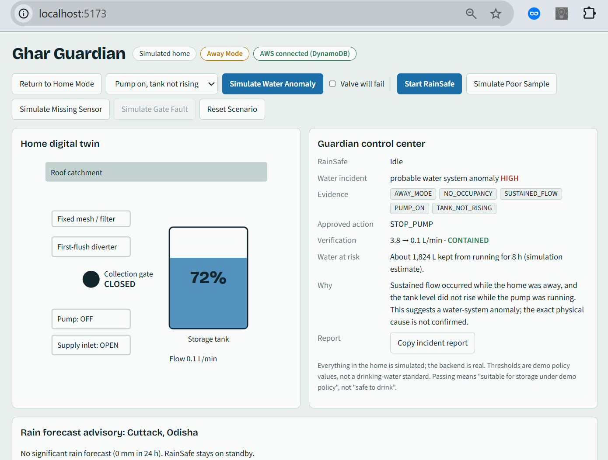
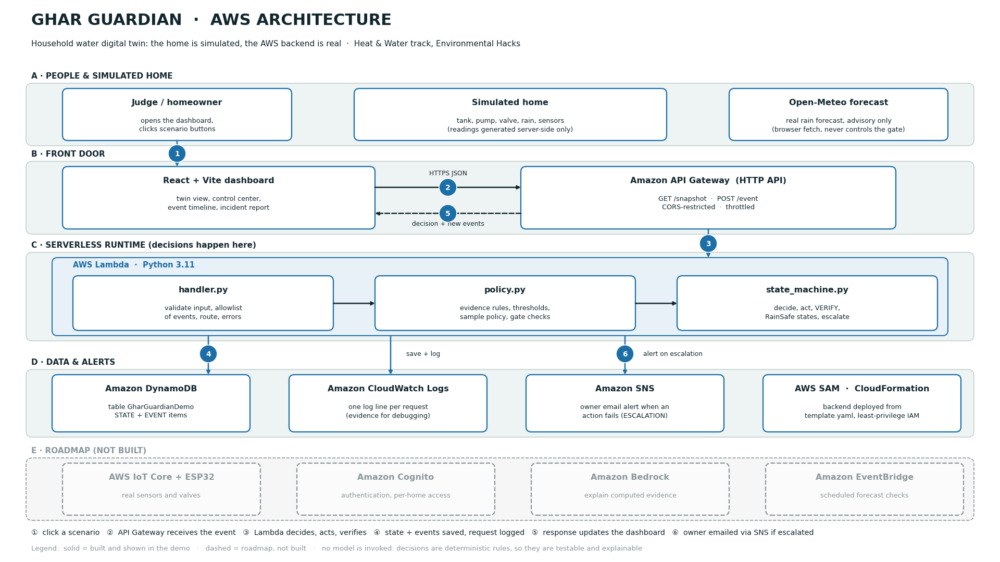
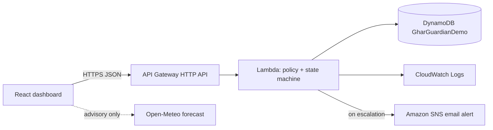

# Ghar Guardian


> Your home watches the water when you can't.

A software-first household water digital twin for **Environmental Hacks** (WeMakeDevs x AWS), Heat & Water track.
The home, sensors, pump, valve and water are **simulated**. The AWS backend is **real**.

[](https://youtu.be/YOUR-VIDEO-ID)

[Watch the demo video on YouTube](https://youtu.be/YOUR-VIDEO-ID)

## What it does
Two workflows, one dashboard, one explainable event timeline:

1. **Away Mode / Water Incident Autopilot**: correlates flow, flow duration, pump state, tank trend and occupancy; picks an allowlisted action (`STOP_PUMP` / `CLOSE_INLET` / `MONITOR_AND_NOTIFY`); then **verifies** with a follow-up sample (`CONTAINED` or `ESCALATED`). If the action fails, the owner is emailed through Amazon SNS.
2. **RainSafe**: first-flush diversion, a configurable collection policy, a tank-capacity-aware gate, and automatic closure at 100%.

The loop: **observe -> correlate evidence -> apply a policy -> act -> verify -> log / escalate.**

Also in the demo: fault injection (valve failure, gate fault, missing sensor, poor sample), a "water at risk" estimate, a copyable incident report, and a real-forecast advisory (advisory only, never controls the gate).

## Try it
| Scenario | Click | Expected result |
|---|---|---|
| Pump anomaly | Activate Away Mode, Simulate Water Anomaly | Evidence chips, `STOP_PUMP`, flow 3.8 -> 0.1, `CONTAINED` |
| Failed action | Tick "Valve will fail", run the anomaly again | Flow stays 3.8, `ESCALATED`, owner alert email via SNS (when configured) |
| Normal use | Home Mode, Simulate Water Anomaly | `NORMAL_USE`, no action |
| Good rain | Start RainSafe | First flush, sample passes, gate opens, tank fills, gate closes at 100% |
| Poor sample | Simulate Poor Sample | Gate stays closed, `REJECTED` |
| Faults | Simulate Missing Sensor / Simulate Gate Fault (while collecting) | `SENSOR_FAULT` / `ACTUATOR_FAULT`; a gate fault also sends an owner alert |

## Real vs simulated
| Real | Simulated |
|---|---|
| Amazon API Gateway, AWS Lambda, Amazon DynamoDB, Amazon SNS, Amazon CloudWatch Logs | The home, tank, pump, valves, rain and every sensor reading |
| Rain forecast from Open-Meteo (advisory only) | Water quality samples (preset profiles) |

## How it works



- `backend/src/policy.py` and `state_machine.py` are pure Python and unit-tested without AWS (17 tests, run in CI).
- The browser sends only event names and enum values. The server generates all simulated readings and picks the action from an allowlist.
- Decisions are deterministic rules, so they are testable and explainable. No AI model is invoked.
- Every decision records evidence codes, a plain-language explanation, the action and the verification outcome.
- The dashboard shows "AWS connected (DynamoDB)" only when the backend reports it actually saved to DynamoDB.

## AWS services used
- **Amazon API Gateway** (HTTP API): `GET /snapshot`, `POST /event`, CORS-restricted and throttled
- **AWS Lambda** (Python 3.11): validation, policy engine, state machine
- **Amazon DynamoDB**: single table `GharGuardianDemo` (`pk`/`sk`), one state item plus event items
- **Amazon SNS**: owner email alert when an action fails and the incident escalates, or the collection gate faults (optional, enabled by giving an email at deploy time)
- **Amazon CloudWatch Logs**: one log line per request
- Deployed with **AWS SAM / CloudFormation** (`backend/template.yaml`) in `us-east-1`, with a least-privilege IAM role

## Limits (honest)
- Does not locate leaks behind walls. It reports a *probable water-system anomaly*, cause not confirmed.
- Does not certify drinking water. Thresholds are demo policy values; "passed" means suitable for storage under demo policy.
- Water-at-risk numbers are simulation estimates (flow x 8 h), not measurements.
- Amazon Bedrock is not used in this submission.
- The demo API has no authentication. All data is simulated.

## Project layout
```
backend/src/policy.py         rules and thresholds (pure Python)
backend/src/state_machine.py  event handling, verification, RainSafe states
backend/src/storage.py        DynamoDB / in-memory storage
backend/src/notify.py         optional owner alerts via Amazon SNS
backend/src/handler.py        Lambda entry point
backend/template.yaml         AWS SAM infrastructure
backend/tests/                unit tests
frontend/src/                 React + Vite dashboard
docs/architecture.png         AWS architecture diagram
.github/workflows/ci.yml      tests and build on every push
```

## Run locally (no AWS)
Prerequisites: Python 3.11+, Node.js 18+.
```
cd backend
python -m unittest discover -s tests -v
python local_server.py            # http://localhost:8787 (in-memory; UI shows "Local API, not AWS")
cd ../frontend && npm install && npm run dev
```
Alerts are off in local mode (no SNS topic is configured).

## Deploy to AWS (SAM)
Prerequisites: AWS CLI and SAM CLI configured. The Lambda `Runtime` in `template.yaml` must match your local Python version.
```
cd backend
sam build
sam deploy --guided --stack-name ghar-guardian
```
- When asked for `AlertEmail`, enter an address for owner alerts, or leave it blank to disable alerts. Confirm the subscription email that SNS sends.
- Put the `ApiUrl` output in `frontend/.env.local` as `VITE_API_URL=...`, then run the dashboard.

Clean up: `sam delete --stack-name ghar-guardian`

## Configuration
Thresholds are demo policy values and can be overridden with environment variables: `FLOW_THRESHOLD`, `DURATION_THRESHOLD`, `TANK_RISE_MIN`, `VERIFY_MAX_FLOW`, `PH_MIN`, `PH_MAX`, `TURBIDITY_MAX_NTU`, `TDS_MAX_PPM`. The Lambda also uses `TABLE_NAME` and `ALERT_TOPIC_ARN`, both set by the SAM template. No credentials are stored in the repository or the frontend.

## Credits and AI disclosure
Built during Environmental Hacks. AI coding assistance: Claude (Anthropic). Libraries: React, Vite. Fonts: Bricolage Grotesque, Source Sans 3 (OFL). Weather data: Open-Meteo.com (CC BY 4.0). Licensed under MIT.
