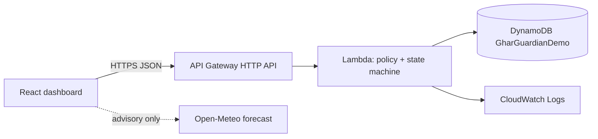

# Ghar Guardian

A software-first household water digital twin for Environmental Hacks (Heat & Water track).
The home, sensors, pump, valve and water are **simulated**. The AWS backend is **real**.

Two workflows, one dashboard, one explainable event timeline:
1. **Away Mode / Water Incident Autopilot**: correlate flow, pump, tank trend, occupancy and duration; pick an allowlisted action (STOP_PUMP / CLOSE_INLET / MONITOR_AND_NOTIFY); verify with a follow-up sample (CONTAINED or ESCALATED).
2. **RainSafe**: first-flush diversion, configurable collection policy, tank-capacity-aware gate, automatic closure at 100%.

Also in the demo: fault injection (valve failure, gate fault, missing sensor), a "water at risk" estimate, a copyable incident report, and a real-forecast advisory (advisory only, never controls the gate).

## Limits (honest)
- Does not locate leaks behind walls. It reports a *probable water-system anomaly*, cause not confirmed.
- Does not certify drinking water. Thresholds are demo policy values; "passed" means suitable for storage under demo policy.
- Water-at-risk numbers are simulation estimates (flow x 8 h), not measurements.
- Bedrock is not used unless a real invocation is implemented and shown.

## Architecture

`backend/src/policy.py` and `state_machine.py` are pure Python, unit-tested without AWS (see CI).
The browser sends only event names and enum values; the server generates all simulated readings and picks the action from an allowlist.

## Run locally (no AWS)
```
cd backend
python -m unittest discover -s tests -v
python local_server.py            # http://localhost:8787 (in-memory; UI shows "Local API, not AWS")
cd ../frontend && npm install && npm run dev
```

## Deploy to AWS (SAM)
```
cd backend && sam build && sam deploy --guided --stack-name ghar-guardian
# put the ApiUrl output in frontend/.env.local as VITE_API_URL=...
```
The UI shows "AWS connected (DynamoDB)" only when the backend reports it actually stored data in DynamoDB.

## Credits and AI disclosure
Built during Environmental Hacks. AI coding assistance: Claude (Anthropic). Libraries: React, Vite. Fonts: Bricolage Grotesque, Source Sans 3 (OFL). Weather data: Open-Meteo.com (CC BY 4.0).
